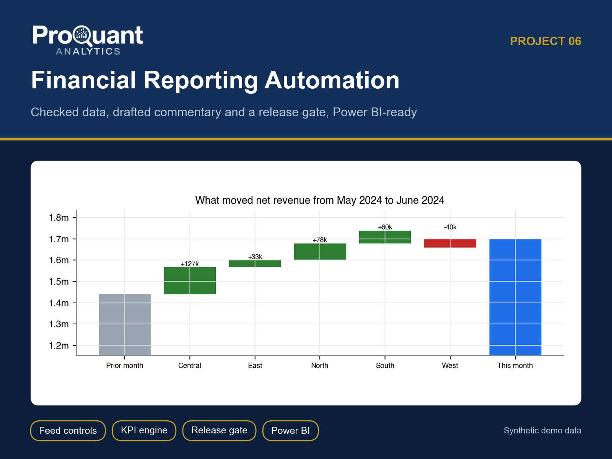
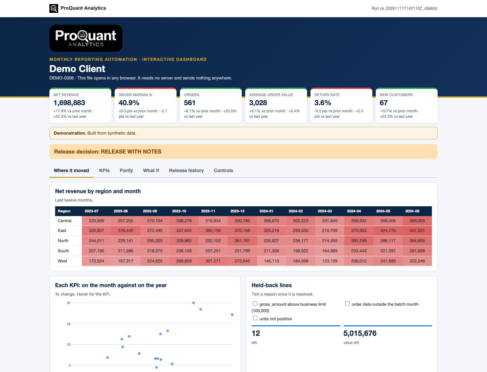
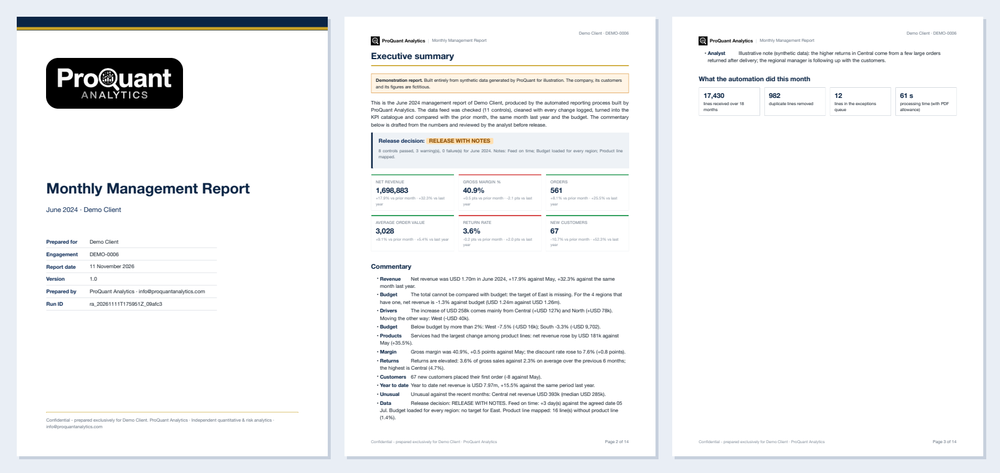
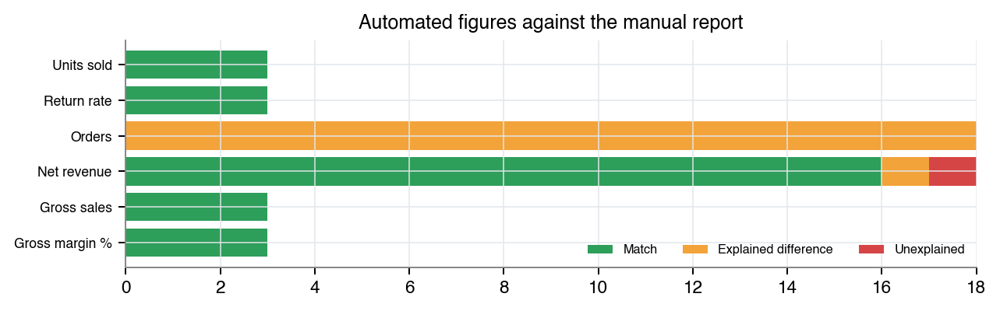
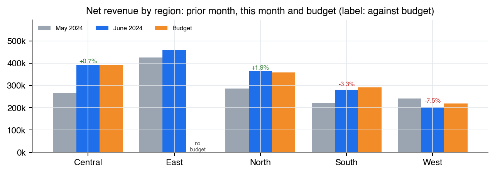
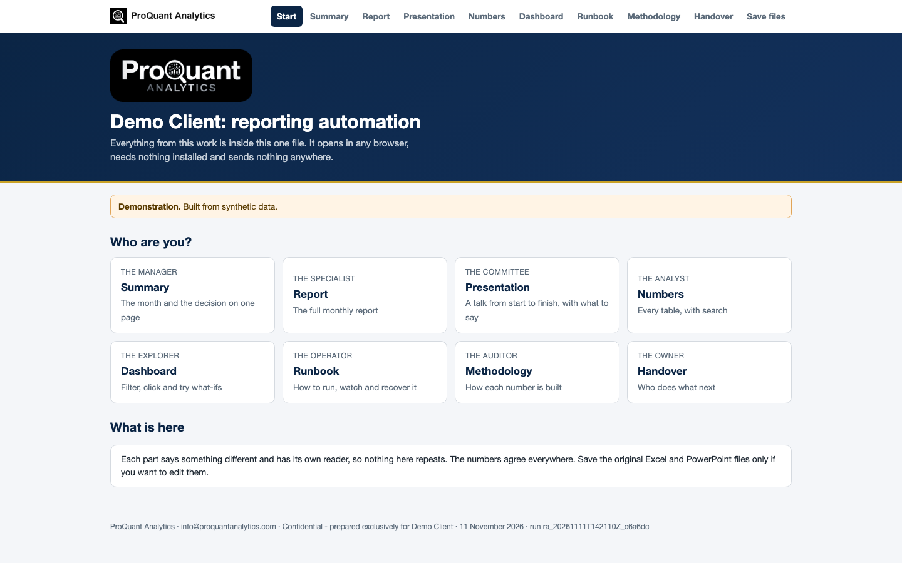

# Financial Reporting Automation

**A monthly report that checks its own data, drafts its commentary and holds itself when it is not safe to release.**

  

> **Showcase repository.** It shows the method and the actual files a client receives, built on **synthetic demo data** (a fictional *Demo Client*). The numbers below are illustrative, not client results. The production code is proprietary and is not published here.

## Contents

- [Business problem](#business-problem)
- [Approach](#approach)
- [Results (demo)](#results-demo)
- [Deliverables](#deliverables)
- [Gallery](#gallery)
- [Tech stack](#tech-stack)
- [How to view it](#how-to-view-it)
- [How an engagement works](#how-an-engagement-works)

## Business problem

The manual report depends on one person, a chain of spreadsheets and a night of copying. Late or duplicated files silently change the numbers, KPIs are defined differently in two tabs, and regional versions are made by hand.

**Typical clients:** Finance, FP&A and sales-operations teams that rebuild the same pack in Excel every month.

## Approach

- Feed controls: arrival, freshness, control totals, volume, coverage and duplicates, with an exceptions queue
- KPI engine from agreed definitions: month, year to date, region and product vs prior year and budget
- Rule-based commentary drafted from the numbers
- Release gate: a failed blocking control holds the report (stamped DRAFT)
- Parity against the old manual report, with every difference explained
- Regional bulletins, email drafts (never sent automatically), scheduler files and a runbook; Power BI-ready exports

## Results (demo)

**Overall opinion on the demo data:** Release decision: RELEASE WITH NOTES

| Measure | Value | Context |
|---|---:|---|
| Net revenue | **1,698,883** | +17.9% vs prior month · +32.3% vs last year |
| Gross margin % | **40.9%** | +0.5 pts vs prior month · -2.1 pts vs last year |
| Orders | **561** | +8.1% vs prior month · +25.5% vs last year |
| Average order value | **3,028** | +9.1% vs prior month · +5.4% vs last year |
| Return rate | **3.6%** | -0.2 pts vs prior month · +2.0 pts vs last year |
| New customers | **67** | -10.7% vs prior month · +52.3% vs last year |

<em>The interactive dashboard (one HTML file: Where it moved, KPIs, Parity, What if, Release history, Controls). <a href="https://abduwars.github.io/proquant-06-reporting-automation/sample-delivery/11_DemoClient_ReportingAutomation_Dashboard_v1.0_20261111.html">Open it live</a>.</em>

## Deliverables

Everything opens from **one file**, *Start here* (no. 1), in any browser: pick your role, read each document, watch the presentation, search the tables and use the dashboard. Each document has one reader and one job, and the numbers agree across all of them. PowerPoint and Excel files open in the browser through Microsoft's free online viewer; *download* gives the original file.

| # | File | Format | What it is |
|---|---|---|---|
| 1 | [Start here](https://abduwars.github.io/proquant-06-reporting-automation/sample-delivery/00_START_HERE_DemoClient.html) | HTML (opens in any browser) | **One file that holds it all**: every document, the presentation, the tables and the dashboard |
| 2 | [Report](sample-delivery/01_DemoClient_ReportingAutomation_Report_v1.0_20261111.pdf) | PDF | Monthly management report (~14 pages): decision, KPIs, commentary, comparisons, regions, products, controls, history, parity, business case |
| 3 | [Summary](sample-delivery/02_DemoClient_ReportingAutomation_Summary_v1.0_20261111.pdf) | PDF | One page: the decision, with no charts |
| 4 | [Presentation](https://view.officeapps.live.com/op/view.aspx?src=https%3A%2F%2Fabduwars.github.io%2Fproquant-06-reporting-automation%2Fsample-delivery%2F03_DemoClient_ReportingAutomation_Presentation_v1.0_20261111.pptx) | PowerPoint · [download](https://raw.githubusercontent.com/AbduWars/proquant-06-reporting-automation/main/sample-delivery/03_DemoClient_ReportingAutomation_Presentation_v1.0_20261111.pptx) | **A full talk**: 13 slides with editable charts and speaker notes, ready to present |
| 5 | [Results Workbook](https://view.officeapps.live.com/op/view.aspx?src=https%3A%2F%2Fabduwars.github.io%2Fproquant-06-reporting-automation%2Fsample-delivery%2F04_DemoClient_ReportingAutomation_ResultsWorkbook_v1.0_20261111.xlsx) | Excel · [download](https://raw.githubusercontent.com/AbduWars/proquant-06-reporting-automation/main/sample-delivery/04_DemoClient_ReportingAutomation_ResultsWorkbook_v1.0_20261111.xlsx) | **The working file**: a Control panel with live formulas, and every table. Opens on a **Read me** sheet with a linked index |
| 6 | [Methodology](sample-delivery/05_DemoClient_ReportingAutomation_Methodology_v1.0_20261111.pdf) | PDF | How the process works (for auditors and the client's IT) |
| 7 | [Handover Note](sample-delivery/06_DemoClient_ReportingAutomation_HandoverNote_v1.0_20261111.pdf) | PDF | What was delivered, this month, acceptance, what we need every month |
| 8 | [Runbook](sample-delivery/07_DemoClient_ReportingAutomation_Runbook_v1.0_20261111.pdf) | PDF | **Operations runbook**: monthly routine, exit codes, what each control means and what to do |
| 9 | [Dashboard](https://abduwars.github.io/proquant-06-reporting-automation/sample-delivery/11_DemoClient_ReportingAutomation_Dashboard_v1.0_20261111.html) | HTML (opens in any browser) | **Interactive dashboard in one file**: opens in any browser, explores the data, tries what-ifs and reads the updated tracker |

**Delivered to clients only, not in this showcase:** scheduler pack, regional bulletins and email drafts.

Also delivered: data-quality reports and long-format CSV / Parquet exports for Power BI or Looker Studio.

<em>The first pages of the PDF report.</em>

## Gallery

<table><tr>
<td width="50%"></td>
<td width="50%"></td>
</tr></table>

<em>The start page: one file, one click, nothing to install.</em>

## Tech stack

Python · pandas · NumPy · matplotlib · Jinja2 + WeasyPrint (PDF) · openpyxl (Excel) · python-pptx (PowerPoint) · pydantic · pytest · Power BI / Looker Studio exports (CSV, Parquet)

Every run is reproducible and audited: data fingerprints, configuration and code version are recorded, data-quality checks run before any calculation, and an automated test suite checks every deliverable (including opening the decks and workbooks in Microsoft Office).

## How to view it

1. **In the browser (nothing to install):** open the [live start page](https://abduwars.github.io/proquant-06-reporting-automation/sample-delivery/00_START_HERE_DemoClient.html) or the [dashboard](https://abduwars.github.io/proquant-06-reporting-automation/sample-delivery/11_DemoClient_ReportingAutomation_Dashboard_v1.0_20261111.html).
2. **Download:** click any PDF, Excel or PowerPoint file in the table above, or clone the repository: `git clone https://github.com/AbduWars/proquant-06-reporting-automation.git`.
3. **On your own data:** this is delivered as a fixed-scope engagement. Write to [info@proquantanalytics.com](mailto:info@proquantanalytics.com).

## How an engagement works

| Step | What happens |
|---|---|
| 1. Discovery call | Your question, your data and the decision the work must support |
| 2. Scope and NDA | Fixed scope, timeline and thresholds agreed **before** any result is seen |
| 3. Data request | A precise list of files or read-only access; personal data pseudonymised |
| 4. Build and interim update | First results, open questions and data issues, early |
| 5. Delivery | The full package above, on your data, with a walk-through |
| 6. Handover | Methodology, runbook where relevant, and optional monthly refresh |

---

<b>ProQuant Analytics</b> · Quant & risk analytics, business analytics, data engineering and AI automation Rotterdam, NL · remote-first <a href="https://www.proquant-analytics.com">www.proquant-analytics.com</a> · <a href="mailto:info@proquantanalytics.com">info@proquantanalytics.com</a> · <a href="https://github.com/AbduWars">All 13 projects</a>

© 2026 ProQuant Analytics. Sample outputs on synthetic data, shown for demonstration. All rights reserved.

